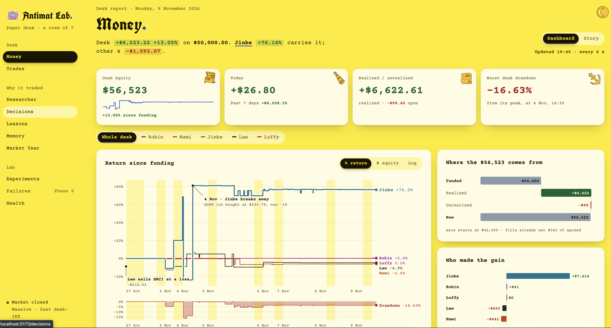

# Antimat Lab

Seven paper traders report to a live web dashboard: five AI traders on a **local Ollama model**, plus two fast rule-based traders with no model or search calls. The AI traders use [MCP](https://modelcontextprotocol.io) servers as their tools.



| Trader | Temperament | Style |
|---|---|---|
| **Robin** | steady | The regime quant: reads the market's regime and the signals that have paid in it; a Synthesizer writes the trade thesis |
| **Nami** | steady | All weather: risk parity across asset classes, a free-text persona she can rewrite |
| **Zoro** | steady | Value: quality at a reasonable price, a fixed playbook |
| **Sanji** | wild | Macro: global macro with trend confirmation, a fixed playbook |
| **Luffy** | wild | Day trader: the opening range breakout, flat every night, with his own Day-Trade Researcher |
| **Jinbe** | impatient | Momentum sprinter: one-minute checks, short holds, exits before the close |
| **Law** | opportunistic | Dip-and-rebound trader: one-minute checks throughout the regular session, may hold overnight |

### Fast desk: Jinbe and Law

The main trading floor starts an independent fast desk, controlled by
`ACTIVE_TRADER_INTERVAL_SECONDS` (default 60, minimum 30). It shares one batch of
Alpaca IEX minute bars and recent trades between the two members. Neither uses
Ollama, Tavily, or the LLM lesson reviewer. Each starts with $10,000 paper cash;
initialization preserves all existing accounts and trading history.

- Jinbe buys five-minute momentum breakouts (+0.15% and above prior bar highs),
  exits at +0.8%, -0.5%, 20 elapsed minutes, or 10 minutes before the exchange close.
- Law buys dips 0.3% below rolling volume-weighted price after an uptick,
  exits at the mean, +0.9%, -0.7%, or 90 elapsed minutes. Overnight exits wait for
  fresh prices next session.
- Both use 15% positions, at most four holdings, a five-minute cooldown after a
  sale, and at most 30 entries per session. Exits remain enabled after the cap.
- The exchange clock handles holidays and early closes. Fresh quotes are required
  (at most 90 seconds old); no fabricated prices, previous-close fills, or forced
  trades. `RUN_EVEN_WHEN_MARKET_IS_CLOSED` does not override this desk.
- Paper fills keep the existing 0.2% cost per side. High turnover can lose money
  quickly. These are unvalidated experimental rules, not promised profits or a
  guaranteed daily trade count. Market-data requests still occur.
- Every open-session tick saves equity; trades and rule decisions appear in the
  normal Money, Trades, Decisions, and Health views. The model label explicitly
  identifies the pair as rules-based. Their memory/research views remain empty.

To add the fast desk alongside an already running older floor without interrupting
its AI cycle, run `uv run -m server.active_traders`. An OS file lock prevents two
fast desks from trading simultaneously. On the next full restart, the normal
`uv run -m server.trading_floor` includes both desks. Restart the API to load the
expanded roster. Keep the engine and computer awake for scheduled exits; exits
cannot run when the engine is stopped or fresh data is unavailable.

## Architecture

```
 Browser ── Client (Vite, :5173) ──/api──► API (FastAPI, :8000)
                                                │ read-only
                                                ▼
 Engine (trading_floor) ──writes──►  accounts.db (SQLite) ◄── Market Year pipeline (daily, after the close)
   every N minutes, 5 traders                                  bars · regimes · scoreboard · news
        │
        ▼ each trader = one agent on Ollama (OpenAI Agents SDK)
   Researcher (sub-agent as a tool)       MCP servers it can call
     Fetch · Tavily search · Memory         Accounts · Market prices · Push · Quant (Robin, Zoro, Sanji)
   Synthesizer (Robin only)                 Day-Trade desk (Luffy)
```

- **Engine** (`server/trading_floor.py`): loops forever. Each cycle runs every trader, then the post-cycle review, then sleeps. Once a day after the close it also runs the Market Year pipeline.
- **Traders** (`server/traders.py`): agents with their own strategy. Zoro (quality at a reasonable price) and Sanji (global macro with trend confirmation) trade fixed playbooks (`server/playbooks.py`) and cannot rewrite them. Nami keeps a persona strategy.
- **Robin** (`server/robin.py`): the regime quant. Robin reads the market regime and the signal scoreboard from the Quant, asks the Researcher only for catalysts, and a Synthesizer sub-agent turns both into a structured trade thesis. A full thesis runs on a regime change or once a day; other cycles only check the drawdown brake.
- **Luffy** (`server/luffy.py`, `server/orb.py`, `server/day_trade_server.py`): the day trader. One technique, the opening range breakout: the first 5-minute bar from 9:30 New York sets the range, and a stock in play (opening volume 1.5x its 14-day average) that closed that bar up and trades above its high is bought, 1% of equity at risk to the range low. The Day-Trade desk (an MCP server, no LLM) computes it all from Alpaca's real-time IEX minute bars; his Researcher only looks for today's catalysts. The floor sells whatever he still holds at 15:50, so he never holds overnight.
- **Quant** (`server/quant_server.py`, `server/quant/`): a deterministic MCP server with no LLM: regimes, signal scoreboard and scans, portfolio risk, position sizing, Zoro's quality screen and DCF, Sanji's macro dashboard.
- **Market Year pipeline** (`server/quant/pipeline.py`): adjusted daily bars from Alpaca (2016 on), features, two regime models (rules and a forward-filtered HMM), the eight-signal scoreboard, the news behind each regime turn, SEC EDGAR fundamentals, and Robin's memory graph.
- **Experiment Lab** (`server/lab/`): runs queued experiments on frozen scenarios, including real-bar regime scenarios for E12–E14.
- **Accounts** (`server/accounts*.py`): balance, holdings, transactions and the portfolio value history, stored in `accounts.db`.
- **Market data** (`server/market*.py`): live prices through Massive if `MASSIVE_API_KEY` is set, otherwise simulated prices.
- **API + client** (`client/`): the API only reads `accounts.db` (except queueing and cancelling experiments). Views: Money, Trades, Researcher, Decisions (with the playbook check and Robin's thesis), Lessons, Memory, Market Year, Experiments, Health.
- **Model** (`local_llm.py`): one place to set the Ollama model for every agent.

A guided tour of the dashboard (the Money tab's Dashboard and Story modes, the chart system and the architecture in depth) is in [docs/first look.md](docs/first%20look.md).

**Architectural Mechanisms** (`/architecture`) is a separate Engineering section with a source-backed 3D system overview, eleven focused mechanisms, guided walkthroughs, a saved-trace inspector, and the five-agent strategy comparison. Use **Present** for recording. Implementation notes and status caveats are in [docs/ARCHITECTURAL_MECHANISMS.md](docs/ARCHITECTURAL_MECHANISMS.md).

## Requirements

[uv](https://docs.astral.sh/uv/) (installs Python 3.12 for you), Node 18+, [Ollama](https://ollama.com), and git.

## Setup

Run once, from the project root:

```bash
git clone https://github.com/ggmaddr/Autonomous-Traders-Lab.git && cd Autonomous-Traders-Lab
uv sync
npm install --prefix client
cp .env.example .env
ollama pull qwen2.5-coder:32b
uv run -m server.reset
uv run -m server.quant
uv run -m server.lab.regime_scenarios
```

In order: install Python and frontend dependencies, create `.env` (then fill in the keys below), pull the local model (about 19 GB), set the strategies and $10,000 for each trader, load the Market Year (bars, regimes, scoreboard, fundamentals, news), and build the Lab's regime scenarios from those bars.

## Run

Use a terminal for each, all from the project root.

The API (docs at http://localhost:8000/docs):

```bash
uv run uvicorn server.api:app --port 8000
```

The frontend (open http://localhost:5173):

```bash
npm run dev --prefix client
```

The traders (Ctrl+C to stop):

```bash
uv run -m server.trading_floor
```

The Experiment Lab worker, which runs experiments queued from the Experiments view:

```bash
uv run -m server.lab
```

### Publish the public dashboard

See [docs/deploy.md](docs/deploy.md) for pushing code, publishing to Cloudflare Pages, and fixing public API connection errors.

### By hand

The engine runs these on its own; run them yourself to refresh now.

Market Year pipeline (bars, regimes, scoreboard, fundamentals, news, Robin's memory):

```bash
uv run -m server.quant
```

The same without the Researcher runs that explain regime turns (no model, no web search):

```bash
uv run -m server.quant --no-news
```

Rebuild the Lab's regime scenarios after the bars change:

```bash
uv run -m server.lab.regime_scenarios
```

Review past trades into lessons:

```bash
uv run -m server.review
```

Reset every account and strategy to the start:

```bash
uv run -m server.reset
```

State lives in `accounts.db` and `memory/`, so stopping and restarting continues where it left off.

## Configuration

Set in `.env` (see `.env.example`):

| Variable | Purpose |
|---|---|
| `TAVILY_API_KEY` | **Required.** Web search for the researcher |
| `ALPACA_API_KEY`, `ALPACA_SECRET_KEY` | **Required for the Market Year.** Daily bar history from Alpaca's data API. Use paper keys; nothing trades through them |
| `SEC_USER_AGENT` | For Zoro's fundamentals from SEC EDGAR, which asks clients to name themselves: `Your Name you@example.com` |
| `MASSIVE_API_KEY` | Optional. Live prices and the real market-open check; simulated prices without it. Orders for unknown tickers are rejected, never filled at a made-up price |
| `RUN_EVERY_N_MINUTES` | Pause between cycles (default 60) |
| `RUN_EVEN_WHEN_MARKET_IS_CLOSED` | Set `true` to trade outside market hours. With a Massive key and the market closed, the engine skips each cycle |
| `PUSHOVER_USER`, `PUSHOVER_TOKEN` | Optional. Phone notifications from the traders |
| `OPENAI_API_KEY` | Optional. Only used to upload traces to platform.openai.com/traces |

Other settings: the model in `local_llm.py`, starting cash in `server/accounts.py`, trader names in `server/trading_floor.py`, persona strategies in `server/reset.py`, playbooks in `server/playbooks.py`, the Market Year symbols in `server/quant/universe.py`.

## Notes

- One local model answers one request at a time, so the five traders take turns and a cycle takes a while. The Market Year's news step runs one Researcher call per regime turn and can take a while the first time.
- `openai` and `openai-agents` are pinned to a tested pair in `pyproject.toml` (`openai` 2.54 breaks `openai-agents` 0.15).
- Run the commands from the project root: the code opens `accounts.db` and `memory/` by relative path.

## License

MIT. Adapted from the MCP capstone of [Ed Donner's agents course](https://github.com/ed-donner/agents).

The crew icons are from [game-icons.net](https://game-icons.net) (by Lorc, Delapouite and contributors, [CC BY 3.0](https://creativecommons.org/licenses/by/3.0/)), through [react-icons](https://react-icons.github.io/react-icons/).


## Public view-only sharing

Ollama, the trading engine, the private API, and the database stay on the desktop.
Cloudflare exposes only `server.public_web` on loopback port 8010. The gateway
serves `client/dist` and an explicit allowlist of GET endpoints. All write methods
are rejected before reaching the private API; the public UI hides experiment
creation and cancellation. Local UI controls remain available on port 5173.
Public GET responses share a 15-second cache (Market Year: five minutes), with
coalesced requests and bounded concurrency. The public UI includes saved trading,
research, memory, and experiment results. Configured credentials are redacted.

With the private API already running on port 8000, build the UI:

```sh
npm run build --prefix client
```

Run each command in its own terminal, from the repository root:

```sh
uv run uvicorn server.public_web:app --host 127.0.0.1 --port 8010 --no-access-log
cloudflared tunnel --url http://127.0.0.1:8010 --no-autoupdate
```

Install the tunnel client once with `brew install cloudflared`. Share the HTTPS
`trycloudflare.com` URL printed by cloudflared. Only tunnel port 8010, not the
private API, Vite development server, or Ollama. Stop cloudflared to end sharing.
Keep the computer awake and connected. Quick Tunnel addresses change on restart;
these processes are not configured to start at login. Rebuild the UI to publish
later frontend edits. Saved account updates appear automatically.

For the initial background session, process logs are in
`/tmp/trading-public-web.log` and `/tmp/trading-cloudflare.log`. Check that an
existing gateway/tunnel is stopped before starting another.

Validate the public boundary offline with:

```sh
uv run python -m unittest server.test_public_web -v
```
